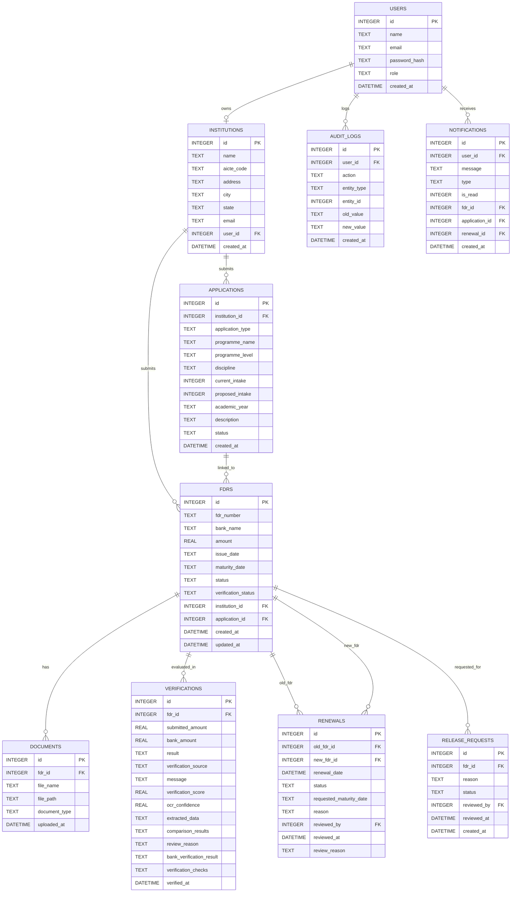

# AICTE FDR Management Portal — Project Context & System Architecture

## 1. Project Purpose
The **AICTE Fixed Deposit Receipt (FDR) Management Portal** is a centralized, digital regulatory compliance platform built for the All India Council for Technical Education (AICTE). Educational and technical institutions submit Security Deposits / Fixed Deposit Receipts to AICTE as a prerequisite for institutional approvals, starting new programmes, increasing approved student intake, or regulatory continuation.

The portal streamlines the end-to-end lifecycle of these security deposits:
- Replacing cumbersome paper-based physical receipt handling with digital submission and document preservation.
- Automating verification via Optical Character Recognition (OCR) to extract deposit details directly from uploaded bank receipts.
- Comparing submitted details against bank records (via mock verification for demonstration purposes).
- Enabling AICTE scrutiny officers to review submissions, inspect automated audit checks, resolve discrepancies, override flagged records, monitor maturity timelines, review renewal requests, and handle deposit release requests.

---

## 2. SIH Problem Statement
- **Problem Statement ID**: `SIH26265`
- **Title**: Streamline of Security Deposit / FDR Portal
- **Domain**: Higher Education Regulation, Financial Compliance, Digital India
- **Core Challenge**: Managing thousands of FDRs across technical institutions throughout India suffers from manual verification bottlenecks, lack of real-time visibility into deposit validity and maturity, vulnerability to forged or altered deposit receipts, and unmonitored maturity leading to lapsed renewals. The prototype addresses these challenges through automated document OCR, simulated bank matching, scoring algorithms, urgency priority indexing, and transparent audit logging.

---

## 3. Technology Stack

### Backend
- **Runtime**: Node.js (`>= 22.13.0`, active v24.19.0)
- **Framework**: Express.js (`v5.3.0`)
- **Database**: SQLite via `better-sqlite3` (`v13.0.3`) with foreign keys enabled (`PRAGMA foreign_keys = ON`)
- **Authentication**: JSON Web Tokens (`jsonwebtoken` `v9.0.3`) with HMAC-SHA256 and `bcryptjs` (`v3.0.3`)
- **File Uploads**: `multer` (`v2.5.0`) with disk storage destination at `backend/src/uploads/fdr/`
- **OCR Engine**: `tesseract.js` (`v7.0.0`) for character recognition + `pdf-to-img` (`v7.0.1`) for multi-page PDF rendering
- **Testing**: Node.js built-in test runner (`node --test`)

### Frontend
- **Framework**: React 19 (`v19.3.1`) + React DOM (`v19.3.1`)
- **Build Tool / Bundler**: Vite (`v8.3.4`)
- **Routing**: `react-router-dom` (`v7.18.4`)
- **Data Visualization**: `recharts` (`v3.10.1`)
- **Iconography**: `lucide-react` (`v1.61.0`) and inline Unicode/SVG symbols
- **HTTP Requests**: Fetch API (native browser) and `axios` (`v1.20.0`)
- **Styling**: Vanilla CSS, modular CSS files, component-scoped `<style>` tags

### Shared Code
- Common utility modules shared across backend and frontend: `shared/fdrPriority.mjs` (ES module priority calculation) and `shared/officerDemoData.json` (seeded demonstration data).

---

## 4. Repository Structure

```text
aicte-fdr-portal/
├── backend/
│   ├── database/
│   │   └── aicte.db                       # Active SQLite database file
│   ├── src/
│   │   ├── database/
│   │   │   ├── database.js                # SQLite database connection setup
│   │   │   ├── init.js                    # Schema definition (DDL) and initial setup
│   │   │   ├── migrations.js              # Schema column & index migrations on startup
│   │   │   └── seed.js                    # Database seed script for institutions & officer accounts
│   │   ├── middleware/
│   │   │   └── auth.js                    # JWT verification and role authorization middleware
│   │   ├── routes/
│   │   │   ├── auth.js                    # Login endpoint (/api/auth/login)
│   │   │   ├── fdr.js                     # FDR submission, view own FDRs, document retrieval
│   │   │   ├── institution.js             # Institution renewal requests, eligibility, notifications
│   │   │   └── officer.js                 # Officer scrutiny, stats, queue, approvals, renewals, reports
│   │   ├── services/
│   │   │   ├── bankVerificationService.js # Mock bank provider and matching checks
│   │   │   ├── complianceService.js       # Institution compliance score calculation
│   │   │   ├── fdrPriorityService.js      # Priority scoring for officer review queue
│   │   │   ├── ocrService.js              # Tesseract.js OCR and field extraction
│   │   │   └── verificationService.js     # Rule engine for 100-point automated verification
│   │   ├── uploads/
│   │   │   └── fdr/                       # Uploaded FDR receipts (PDF, PNG, JPG)
│   │   └── server.js                      # Express app bootstrap, CORS, router mounting
│   ├── test/
│   │   ├── fdrPriority.test.js            # Node unit tests for priority calculation
│   │   ├── verification.test.js           # Node unit tests for verification and mock bank
│   │   └── fixtures/                      # Sample test FDR PDF fixtures
│   ├── .env                               # Backend environment configuration
│   ├── .env.example                       # Example environment file
│   └── package.json
│
├── frontend/
│   ├── dist/                              # Production build output
│   ├── public/
│   │   ├── favicon.svg
│   │   └── icons.svg
│   ├── src/
│   │   ├── api/
│   │   │   └── api.js                     # Institution API client functions
│   │   ├── assets/                        # Static image assets
│   │   ├── components/
│   │   │   ├── AutomatedVerificationResult.jsx # Verification score & comparison badge component
│   │   │   ├── AutomatedVerificationResult.css
│   │   │   ├── FdrPriority.jsx            # Priority pill badge component
│   │   │   ├── FdrPriority.css
│   │   │   ├── InstitutionLayout.jsx      # Sidebar & header layout for institution views
│   │   │   ├── OfficerFdrDetailsModal.jsx # Detailed FDR modal dialog for officer inspection
│   │   │   ├── OfficerFdrDetailsModal.css
│   │   │   ├── OfficerLayout.jsx          # Dedicated layout wrapper with officer sidebar
│   │   │   ├── OfficerLayout.css
│   │   │   ├── OfficerReports.jsx         # Analytics charts & breakdown panels
│   │   │   ├── OfficerReports.css
│   │   │   ├── Sidebar.jsx                # [EMPTY - 0 bytes placeholder]
│   │   │   ├── StatCard.jsx               # [EMPTY - 0 bytes placeholder]
│   │   │   ├── Topbar.jsx                 # [EMPTY - 0 bytes placeholder]
│   │   │   └── FDRCard.jsx                # [EMPTY - 0 bytes placeholder]
│   │   ├── pages/
│   │   │   ├── Dashboard.jsx              # Institution main dashboard
│   │   │   ├── Documents.jsx              # FDR Documents placeholder page
│   │   │   ├── FDRs.jsx                   # My FDRs list with expandable verification details
│   │   │   ├── Login.jsx                  # Unified login page
│   │   │   ├── Notifications.jsx          # Institution notification center
│   │   │   ├── OfficerDashboard.jsx       # AICTE Officer primary control center & metrics
│   │   │   ├── OfficerWorkspace.jsx       # Multi-section workspace for institutions, queue, logs, etc.
│   │   │   ├── Renewals.jsx               # Institution renewal application & tracking
│   │   │   └── SubmitFDR.jsx              # Multi-step FDR deposit submission form
│   │   ├── services/
│   │   │   └── api.js                     # Officer API client functions & auth login
│   │   ├── utils/
│   │   │   ├── fdrPriority.js             # Frontend re-export of shared priority calculator
│   │   │   └── officerAnalytics.js        # Analytics aggregations, date helpers, status colors
│   │   ├── App.jsx                        # Client router mapping
│   │   ├── App.css
│   │   ├── index.css                      # Global design system variables & styles
│   │   └── main.jsx                       # React entry point
│   ├── .env                               # Frontend environment config (VITE_API_URL)
│   ├── package.json
│   └── vite.config.js
│
├── shared/
│   ├── fdrPriority.mjs                    # Shared priority rules & calculation engine
│   └── officerDemoData.json               # Seed fixtures for institutions, users, FDRs, renewals
│
├── .gitignore
├── PROJECT_CONTEXT.md                     # Architecture and context documentation (this file)
└── README.md
```

---

## 5. Frontend Architecture
- **Single Page Application (SPA)** using Vite and React 19.
- **Client-Side Routing**: Handled by `react-router-dom` in `src/App.jsx`.
- **State Management**: Local React state (`useState`, `useEffect`, `useMemo`, `useCallback`). There is no external state library like Redux or Zustand; state is scoped per page.
- **Authentication State**: Persistent tokens (`token`) and user metadata (`user`) stored directly in browser `localStorage`.
- **Layout Patterns**:
  - `InstitutionLayout.jsx`: Used primarily by `Renewals.jsx` and `Notifications.jsx`, featuring institutional navigation with dynamic unread notification pill count.
  - Manual Page Layouts: `Dashboard.jsx`, `FDRs.jsx`, `SubmitFDR.jsx`, and `Documents.jsx` currently duplicate their own `<aside className="sidebar">` and `<header className="topbar">` structure.
  - `OfficerLayout.jsx`: Wraps `OfficerDashboard.jsx` and `OfficerWorkspace.jsx` with an officer-specific sidebar containing 12 workspace links.
- **API Communication**: Native `fetch` wrapped inside two client files (`src/api/api.js` for institution endpoints; `src/services/api.js` for officer endpoints). Notice that `Login.jsx` and `SubmitFDR.jsx` contain direct hardcoded `fetch("http://localhost:5000/...")` calls.
- **Charts and Visualizations**: Rendered using `recharts` (`ResponsiveContainer`, `BarChart`, `PieChart`, `Cell`, `Tooltip`, `XAxis`, `YAxis`).

---

## 6. Backend Architecture
- **RESTful API** built on Express 5.
- **Synchronous SQLite Access**: Handled via `better-sqlite3`, providing fast in-process database operations without an asynchronous ORM layer.
- **Startup Migrations**: On backend launch, `server.js` calls `database/migrations.js` which verifies tables, injects missing columns (`description`, `verification_score`, `ocr_confidence`, etc.), converts `renewals` table to allow null `new_fdr_id`, and adds indices.
- **Multipart Form Uploads**: `multer` handles file uploads (`max 5MB`, accepted types: `application/pdf`, `image/jpeg`, `image/png`).
- **OCR Processing Service**:
  - `ocrService.js` creates a singleton worker with Tesseract.js.
  - For PDF files, `pdf-to-img` extracts rendered page image buffers before running Tesseract.
  - RegEx rules extract `fdrNumber`, `bankName`, `amount`, `issueDate`, and `maturityDate`.
- **Automated Verification Pipeline**:
  - Runs in real-time upon FDR upload inside the POST `/api/fdr` transaction.
  - Evaluates institutional ownership, OCR field parity, document OCR score, mock bank confirmation, and duplicate number checks.
- **Audit Logging**: Every action (`FDR_SUBMITTED`, `DOCUMENT_UPLOADED`, `OCR_COMPLETED`, `BANK_VERIFICATION_*`, `OFFICER_REVIEWED`, `RENEWAL_*`) is recorded in `audit_logs`.

---

## 7. Database Structure

SQLite database located at `backend/database/aicte.db`. Foreign key enforcement is turned ON.



---

## 8. Authentication
- **Mechanism**: JSON Web Token (JWT) sent via HTTP Authorization header: `Bearer <token>`.
- **Secret**: Managed via `process.env.JWT_SECRET` (defaults to `"development-secret-change-this"` if not set).
- **Token Payload**: `{ userId: user.id, role: user.role }`, valid for 8 hours.
- **Password Storage**: Hashed using `bcryptjs` with salt round factor of 10.
- **Middleware**:
  - `authenticateToken`: Validates Authorization header, decodes token, populates `req.user`.
  - `requireRole(...roles)`: Verifies `req.user.role` matches permitted roles (`INSTITUTION`, `OFFICER`, `ADMIN`).

---

## 9. User Roles

### 1. Institution (`role: 'INSTITUTION'`)
- Registered educational college/university entity submitting security deposits.
- **Capabilities in Code**:
  - Submits new FDR along with PDF/Image document and regulatory application purpose (`SubmitFDR.jsx` -> `POST /api/fdr`).
  - Views automated verification output, OCR field comparisons, and mock bank response immediately upon submission.
  - Lists institutional FDRs, monitors maturity status, and opens stored FDR receipt documents (`FDRs.jsx` -> `GET /api/fdr/my` and `GET /api/fdr/:id/documents/:docId`).
  - Checks renewal eligibility within 90 days of maturity and submits renewal requests (`Renewals.jsx` -> `GET /api/institution/renewals/eligible-fdrs`, `POST /api/institution/renewals`).
  - Submits replacement receipt linked to an approved renewal (`SubmitFDR.jsx` with type `RENEWAL` + `previousFdrNumber`).
  - Reads notifications and marks individual or all notifications as read (`Notifications.jsx` -> `GET /api/institution/notifications`, `PATCH /api/institution/notifications/:id/read`).

### 2. AICTE Officer (`role: 'OFFICER'`)
- AICTE administrative scrutiny officer reviewing security deposits.
- **Capabilities in Code**:
  - Officer Dashboard (`OfficerDashboard.jsx`): Real-time metrics on total FDRs, verified deposits, flagged records, failed checks, total deposit portfolio, and visual charts.
  - Verification Queue (`OfficerWorkspace.jsx?section=verification`): Prioritized list of unverified or flagged deposits sorted by urgency priority score.
  - Deep Inspection Modal (`OfficerFdrDetailsModal.jsx`): Inspects OCR confidence, field-by-field comparisons, raw extracted text, mock bank checks, and uploaded receipt document.
  - Scrutiny Decisions: Manually verify (`PATCH /api/officer/fdrs/:id/verify`), reject (`PATCH /api/officer/fdrs/:id/reject`), or record override decision (`POST /api/officer/fdrs/:id/override`).
  - On-Demand Reruns: Trigger automated re-verification (`POST /api/officer/fdrs/:id/run-verification`) or re-run mock bank match (`POST /api/officer/fdrs/:id/bank-verify`).
  - Renewals Review (`OfficerWorkspace.jsx?section=renewals`): Evaluates renewal requests, transitions them to `UNDER_REVIEW`, `APPROVED`, `ACTION_REQUIRED`, or `REJECTED`.
  - Release Requests (`OfficerWorkspace.jsx?section=release-requests`): Reviews deposit release requests submitted by institutions.
  - Institution Directory & Compliance (`OfficerWorkspace.jsx?section=institutions`): Evaluates institutional deposit histories and compliance scores.
  - Reports & Analytics (`OfficerReports.jsx`): Status distribution pie charts, 6-month expiry forecast bars, maturity risk breakdown, and bank portfolio share.
  - Audit Logs (`OfficerWorkspace.jsx?section=audit-log`): Comprehensive timeline of all portal activities with JSON payload diffs.

### 3. Administrator (`role: 'ADMIN'`)
- Recognized in database enum (`CHECK(role IN ('INSTITUTION', 'OFFICER', 'ADMIN'))`) and permitted in several officer scrutiny endpoints (`requireRole("OFFICER", "ADMIN")`).
- *Note*: Currently does not have a dedicated UI route or admin dashboard in the frontend.

---

## 10. Route Map

### Frontend Routes (`frontend/src/App.jsx`)

| Route Path | Component | Target Role | Primary Purpose |
| :--- | :--- | :--- | :--- |
| `/` | `Login.jsx` | Public | User authentication and redirection |
| `/dashboard` | `Dashboard.jsx` | Institution | Summary metrics, recent submissions, expiry alerts |
| `/fdrs` | `FDRs.jsx` | Institution | List submitted FDRs, view verifications, open documents |
| `/submit-fdr` | `SubmitFDR.jsx` | Institution | Upload document & submit deposit with purpose details |
| `/renewals` | `Renewals.jsx` | Institution | Track renewal eligibility, submit renewal request, view timeline |
| `/notifications` | `Notifications.jsx` | Institution | Institutional alert inbox and read status management |
| `/documents` | `Documents.jsx` | Institution | Dedicated documents management view (currently placeholder) |
| `/officer` | `OfficerDashboard.jsx` | Officer | Officer control center, KPI cards, charts, urgent tasks |
| `/officer/:section` | `OfficerWorkspace.jsx` | Officer | Sub-pages: `institutions`, `fdrs`, `verification`, `renewals`, `release-requests`, `reports`, `audit-log`, `users`, `master-data`, `settings`, `help`, `notifications` |

---

## 11. FDR Lifecycle

```text
[ Institution ]
       │
       ▼
1. SUBMIT FDR ───► Upload receipt + fill details + purpose (New, Renewal, Increase Intake, etc.)
       │
       ▼
2. AUTOMATED OCR ──► Tesseract.js extracts: FDR number, Bank, Amount, Issue Date, Maturity Date
       │
       ▼
3. MOCK BANK CHECK ──► Matches details against mock bank ledger (MOCK_BANK_RECORDS_JSON)
       │
       ▼
4. VERIFICATION ENGINE ──► Calculates 100-point score; assigns PENDING, FLAGGED, or VERIFIED
       │
       ▼
5. NOTIFICATIONS & AUDIT ──► Audit log recorded; in-app notification sent to Institution & Officers
       │
       ▼
[ AICTE Officer Scrutiny ]
       │
       ├──► Verification Queue (Priority sorted by Urgency / Risk Score)
       ├──► Inspect FDR Details Modal (OCR vs Submitted comparisons & original document)
       ├──► Scrutiny Action: Verify / Reject / Override
       │
       ▼
6. MATURITY MONITORING ──► Daily maturity tracking: Normal (>90d), Expiring Soon (30-90d), Critical (<30d), Matured
       │
       ▼
7. RENEWAL WORKFLOW ──► Eligible within 90 days of maturity:
       │                 • Institution requests renewal (requested maturity date + reason)
       │                 • Officer reviews & approves renewal request
       │                 • Institution submits new receipt with applicationType 'RENEWAL'
       │                 • System links old FDR to new FDR and marks renewal COMPLETED
       │
       ▼
8. RELEASE REQUEST ──► Institution requests deposit release upon course closure or compliance fulfillment
       │                 • Officer reviews release request (Approve / Reject)
       │
       ▼
9. AUDIT & HISTORY ──► Full immutable lifecycle trail preserved in `audit_logs`
```

---

## 12. OCR Workflow
- **File Location**: `backend/src/services/ocrService.js`
- **Engine**: `tesseract.js` worker (`eng` language), rendering PDF pages into images using `pdf-to-img` (scale factor: 2).
- **Supported File Types**: `.pdf`, `.png`, `.jpg`, `.jpeg` (maximum 10 pages for PDF).
- **Extracted Fields**:
  1. `fdrNumber`: Matching labels `FDR Number`, `FDR No`, `Fixed Deposit Receipt No`, `Receipt No`.
  2. `bankName`: Matching `Bank Name`, `Bank`.
  3. `amount`: Parsed currency tokens (`₹`, `Rs.`, `INR`) and numeric amounts.
  4. `issueDate`: Parsed ISO (`YYYY-MM-DD`) or Indian date (`DD/MM/YYYY`, `DD-MM-YYYY`).
  5. `maturityDate`: Matching `Maturity Date`, `Date of Maturity`.
- **Confidence Scoring**: Line-level and overall arithmetic mean confidence from Tesseract.
- **Threshold**: Requires `overall confidence >= 80%` (`OCR_CONFIDENCE_THRESHOLD = 80`) and all 5 mandatory fields to achieve status `SUCCESS`. Otherwise, returns `LOW_CONFIDENCE` or `FAILED`.
- **Handling OCR Failure**: If OCR fails or is unreadable, submission does NOT crash; it records `extractionFailure: true`, marks verification as `FLAGGED` or `FAILED`, logs an `OCR_FAILED` audit entry, and queues the FDR for officer scrutiny.

---

## 13. Bank Verification Workflow
- **File Location**: `backend/src/services/bankVerificationService.js`
- **Nature**: Simulated / Mock Verification. No direct live bank integration (API gateway / SFMS / core-banking) exists in this prototype.
- **Providers**:
  1. `mockBankVerificationProvider` (Default): Returns deterministic `status: "PENDING"`, `verified: false`, indicating deposit awaits external confirmation.
  2. `createConfiguredMockBankProvider()`: Reads simulated ledger records from environment variable `MOCK_BANK_RECORDS_JSON`.
- **Matching Rules**: Matches submitted FDR against mock records by `fdrNumber` and `bankName`. Performs strict verification checks across:
  - `exists`: Deposit exists in bank ledger
  - `fdrNumber`: Exact number match
  - `bank`: Bank name match
  - `amount`: Exact monetary value match
  - `issueDate`: Normalized date match
  - `maturityDate`: Normalized date match
  - `activeStatus`: Must be marked active
- **Possible Statuses**: `VERIFIED`, `MISMATCH` (discrepancy identified), `NOT_FOUND` (no mock record present), `FAILED`, `PENDING`.

---

## 14. Existing Pages

### Institution Pages
1. **Login (`/`)**: Dual login screen supporting institution and officer credentials with demo quick-reference.
2. **Dashboard (`/dashboard`)**: KPI stat cards (Total FDRs, Active, Expiring in 90 Days, Total Amount), institution information badge, and recent submissions table.
3. **Submit FDR (`/submit-fdr`)**: Form capturing regulatory purpose (New Programme, Intake Increase, Renewal, Replacement, etc.), FDR numbers, bank, dates, amounts, document attachment, and live automated verification result card.
4. **My FDRs (`/fdrs`)**: Comprehensive table of submitted FDRs with status filters, search, document view link, and expandable automated verification results.
5. **Renewals (`/renewals`)**: Renewal request dashboard, 90-day eligibility check table, modal application form, and audit timeline.
6. **Notifications (`/notifications`)**: Inbox categorizing FDR, verification, and renewal notifications with mark-read toggles.
7. **Documents (`/documents`)**: Informational view explaining stored receipts (currently placeholder).

### Officer Pages
8. **Officer Dashboard (`/officer`)**: High-level KPI summary, interactive charts (Status Distribution, Expiry Forecast), priority breakdown, urgent task alerts, and recent FDR table.
9. **Institutions (`/officer/institutions`)**: Directory of colleges, contact details, deposit counts, portfolio values, and automated institutional compliance scores.
10. **FDR Management (`/officer/fdrs`)**: Global repository of all submitted FDRs across all institutions with multi-parameter filtering (status, bank, application, priority, dates).
11. **Verification Queue (`/officer/verification`)**: Action-oriented queue of flagged or unverified FDRs ordered by urgency priority, with one-click access to the scrutiny modal.
12. **Renewals Workspace (`/officer/renewals`)**: Review panel to approve, reject, or request action on institutional renewal applications.
13. **Release Requests (`/officer/release-requests`)**: Adjudication workspace for deposit release submissions.
14. **Reports & Analytics (`/officer/reports`)**: Deep financial analytics including bank risk concentration, upcoming maturity lists, and portfolio composition.
15. **Audit Log (`/officer/audit-log`)**: Immutable audit history of system events, logins, submissions, and status changes.
16. **Manage Users (`/officer/users`)**: Listing of institutional and officer accounts.
17. **Master Data (`/officer/master-data`)**: View-only reference lists of registered banks, programme levels, and disciplines.
18. **Settings (`/officer/settings`)**: Officer profile management and notification preference toggles.
19. **Help & Support (`/officer/help`)**: System documentation, FAQs, and regulatory requirements.

---

## 15. Existing APIs

### Authentication (`/api/auth`)
- `POST /api/auth/login`: Authenticate email & password; returns JWT token and user profile.

### FDR Submissions & Management (`/api/fdr`)
- `POST /api/fdr`: Submit new FDR + upload document + run OCR + run mock bank match + calculate score (Institution only).
- `GET /api/fdr/my`: Retrieve all FDRs submitted by the logged-in institution with latest verification results.
- `GET /api/fdr/:id/documents/:documentId`: Stream and download an uploaded FDR document file.

### Institution Services (`/api/institution`)
- `GET /api/institution/renewals/eligible-fdrs`: List institution's FDRs evaluated for 90-day renewal eligibility.
- `GET /api/institution/renewals`: List all renewal requests submitted by the institution.
- `POST /api/institution/renewals`: Submit a new renewal request for an eligible active FDR.
- `GET /api/institution/renewals/:id`: Fetch specific renewal request details, verification summary, and timeline.
- `GET /api/institution/notifications`: Get notification inbox for the logged-in institution.
- `PATCH /api/institution/notifications/:id/read`: Mark an individual notification as read.
- `PATCH /api/institution/notifications/read-all`: Mark all notifications as read.

### Officer Services (`/api/officer`)
- `GET /api/officer/stats`: Quick statistical count for officer dashboard.
- `GET /api/officer/dashboard`: Comprehensive dashboard metrics and recent submissions.
- `GET /api/officer/fdrs`: Retrieve all FDRs across all institutions with search and filter support.
- `GET /api/officer/fdrs/:id`: Fetch complete details, verification records, and documents for an FDR.
- `GET /api/officer/fdrs/:id/documents/:documentId`: Download document file for officer scrutiny.
- `GET /api/officer/fdrs/:id/timeline`: Activity and audit timeline for a specific FDR.
- `GET /api/officer/verification-queue`: List of pending or flagged FDRs needing officer scrutiny.
- `PATCH /api/officer/fdrs/:id/verify`: Mark FDR verified (requires all checks and bank verification pass).
- `PATCH /api/officer/fdrs/:id/reject`: Mark FDR rejected with officer reason.
- `POST /api/officer/fdrs/:id/override`: Record officer override decision (`APPROVE` or `REJECT`).
- `POST /api/officer/fdrs/:id/run-verification`: Re-run automated verification and OCR on existing record.
- `POST /api/officer/fdrs/:id/bank-verify`: Re-run mock bank verification against configured records.
- `GET /api/officer/institutions`: List registered institutions with compliance metrics.
- `GET /api/officer/institutions/:id`: Details, FDRs, and applications for a specific institution.
- `GET /api/officer/institutions/:id/compliance`: Detailed 100-point compliance score breakdown for an institution.
- `GET /api/officer/renewals`: List all renewal requests across all institutions.
- `PATCH /api/officer/renewals/:id/review`: Record officer decision on renewal (`UNDER_REVIEW`, `APPROVED`, `ACTION_REQUIRED`, `REJECTED`).
- `GET /api/officer/release-requests`: List pending and reviewed release requests.
- `PATCH /api/officer/release-requests/:id`: Approve or reject a release request.
- `GET /api/officer/reports`: Summary aggregations by bank, application type, and maturity.
- `GET /api/officer/audit-logs`: Query system audit events.
- `GET /api/officer/users`: List users registered in the system.
- `GET /api/officer/master-data`: Distinct banks, disciplines, and application types.
- `GET /api/officer/me`: Get officer profile details.
- `PATCH /api/officer/me`: Update officer name and email.
- `GET /api/officer/notifications`: Get officer notifications.
- `PATCH /api/officer/notifications/:id/read`: Mark officer notification read.
- `PATCH /api/officer/notifications/read-all`: Mark all officer notifications read.

---

## 16. Existing Mock & Demo Data
1. **Pre-Seeded Login Accounts (`database/seed.js`)**:
   - Institution: `admin@abc.ac.in` / `ABC@12345` (linked to `ABC`, code `AICTE-MH-001`).
   - AICTE Officer: `officer@aicte.gov.in` / `AICTE@12345`.
2. **Demo Fixtures (`shared/officerDemoData.json`)**:
   - 5 Institutions: Western Institute (Pune), Konkan School (Mumbai), Sahyadri College (Nashik), Narmada Institute (Surat), Deccan School (Bengaluru).
   - 14 Demo FDRs across varying banks (SBI, HDFC, ICICI, Axis, PNB, BoB) with realistic deposit amounts (₹7L to ₹16L) and statuses (`ACTIVE`, `SUBMITTED`, `MATURED`, `RELEASE_REQUESTED`).
   - 3 Demo Renewal Requests.
3. **Mock Bank Ledger (`backend/.env`)**:
   - `MOCK_BANK_RECORDS_JSON`: Pre-configured JSON records matching test FDR numbers (`DEMO-FDR-2026-73942`, `DEMO-FDR-2026-84216`, `SBI/FDR/98231`).
4. **Hardcoded Frontend UI Placeholders**:
   - Hardcoded notification items in `OfficerDashboard.jsx` (lines 357–385).
   - Hardcoded release request rows in `OfficerDashboard.jsx` (lines 333–355).
   - Hardcoded institution name "ABC" in `Dashboard.jsx`, `SubmitFDR.jsx`, and `Documents.jsx`.

---

## 17. Existing UI Design System
- **Color Palette**:
  - Primary Corporate Navy: `#0f294a`, `#123b73`, `#1674bb`
  - Accent / Focus Blue: `#0066cc`, `#175cd3`
  - Background Neutral: `#f5f7fa`, `#f8fafc`
  - Panel & Card Background: `#ffffff`, Border: `#e2e8f0`, `#eaecf0`
  - Success Green: `#067647`, `#e8f5ed`, `#1d8b68`
  - Warning / Attention Amber: `#b54708`, `#fff4e5`, `#df9a28`
  - Error / Alert Red: `#b42318`, `#fee4e2`, `#c54852`
  - Text Primary: `#172033`, `#1e293b`, Secondary: `#64748b`, `#718196`
- **Typography**: Clean system sans-serif (`-apple-system, BlinkMacSystemFont, "Segoe UI", Roboto, Helvetica, Arial, sans-serif`).
- **Cards & Layout**: Bordered card panels (`border: 1px solid #eaecf0; border-radius: 8px to 12px; padding: 18px to 24px; box-shadow: 0 1px 3px rgba(0,0,0,0.05)`).
- **Badges**: Pill-shaped status badges with uppercase text and 700 font weight (`border-radius: 14px; padding: 4px 10px; font-size: 11px`).
- **Tables**: Full-width bordered tables with light grey uppercase headers (`background: #f8fafc; font-size: 10px; text-transform: uppercase`), cell padding `12px 14px`, and subtle bottom borders.

---

## 18. Important Components

| Component | Path | Responsibility |
| :--- | :--- | :--- |
| `AutomatedVerificationResult` | `frontend/src/components/AutomatedVerificationResult.jsx` | Renders 100-point score, OCR confidence, mock bank status, and field comparison grid. |
| `FdrPriority` / `FdrPriorityBadge` | `frontend/src/components/FdrPriority.jsx` | Visual badge displaying urgency priority (`Critical`, `High`, `Medium`, `Low`) with tooltip. |
| `InstitutionLayout` | `frontend/src/components/InstitutionLayout.jsx` | Navigation sidebar with live unread notification count badge and header. |
| `OfficerLayout` | `frontend/src/components/OfficerLayout.jsx` | 12-item navigation sidebar for AICTE Officer workspace views. |
| `OfficerFdrDetailsModal` | `frontend/src/components/OfficerFdrDetailsModal.jsx` | Full-screen inspection modal showing comparisons, OCR raw text, and document viewer. |
| `OfficerReports` | `frontend/src/components/OfficerReports.jsx` | Graphical portfolio dashboards, pie charts, expiry bars, and bank distribution metrics. |

---

## 19. Bug & Gap Resolution Register

### Resolved Issues
1. **[RESOLVED] Hardcoded Localhost API URLs in Frontend Pages**:
   - Updated `frontend/src/pages/Login.jsx` and `frontend/src/pages/SubmitFDR.jsx` to use `${import.meta.env.VITE_API_URL || "http://localhost:5000/api"}`.
2. **[RESOLVED] Missing `/admin` Route in App.jsx**:
   - Added `<Route path="/admin" element={<OfficerDashboard />} />` to `App.jsx`.
3. **[RESOLVED] Officer Discretionary Override**:
   - Removed the blocking check in `backend/src/routes/officer.js` (`POST /fdrs/:id/override`) so officers can exercise legitimate human discretion to approve FDRs with mandatory remarks even when automated OCR or mock bank checks are pending.
4. **[RESOLVED] Institution Release Request Lifecycle**:
   - Backend endpoints `GET /api/institution/release-requests` and `POST /api/institution/release-requests` added to `institution.js` with validation, audit logging, and notifications.
   - Updated `PATCH /release-requests/:id` in `officer.js` to set `fdrs.status = 'RELEASED'` on approval and revert to `'ACTIVE'` on rejection.
   - Frontend UI in `FDRs.jsx` now provides a "Request Release" button, structured modal dialog, status badge transitions (`ACTIVE` -> `Pending Release` -> `Released`), and success alerts.
5. **[RESOLVED] Documents Center**:
   - Connected `frontend/src/pages/Documents.jsx` to live APIs (`getInstitutionFdrs` & `getInstitutionFdrDocument`).
   - Implemented KPI metrics cards, status filter, real-time search, and instant document preview in a new tab via blob URL.
6. **[RESOLVED] Dynamic Multi-Tenancy & Consistent Navigation**:
   - Dynamic user/institution identity across `Dashboard.jsx`, `FDRs.jsx`, `SubmitFDR.jsx`, `Documents.jsx`, and `InstitutionLayout.jsx`.
   - Added "Documents" navigation link across all institutional sidebar menus.
7. **[RESOLVED] Live Officer Dashboard Widgets**:
   - `OfficerDashboard.jsx` now loads and displays live release requests from the database in the scrutiny table while preserving demo fallback records if none exist.
   - Officer notifications dynamically display live notifications without duplicating demo tasks.
8. **[RESOLVED] AICTE Lien / Joint Holder Verification**:
   - Added `aicte_lien_check` in `verificationService.js` to check for AICTE joint holder and lien endorsements in document OCR text.

---

## 20. Remaining System Characteristics
1. **Mock Bank Gateway**: Preserved mock JSON bank verification for local testing and demonstration purposes where real core banking APIs are unavailable.
2. **Demonstration & Synthetic Data**: Preserved all existing demo data and fallback JSON fixtures in `shared/officerDemoData.json` and frontend components to ensure complete presentation fidelity during evaluation.

---

## 21. Important Dependencies Between Features
- **FDR Submission ──► OCR ──► Mock Bank ──► Verification Engine**: When an institution uploads an FDR receipt, the submission handler synchronously triggers Tesseract OCR, invokes the mock bank matching provider, aggregates verification checks into a 100-point score, writes the FDR and initial verification record, creates audit entries, and generates notifications inside a single database transaction.
- **Renewals ──► Existing FDRs**: Submitting a renewal request requires an active FDR within 90 days of maturity. Completing the renewal requires submitting a new FDR with `applicationType = 'RENEWAL'` referencing `previousFdrNumber`, which updates the renewal record with `new_fdr_id`.
- **Officer Priority Queue ──► Verification Results & Maturity**: The priority score (Critical, High, Medium, Low) dynamically factors in maturity days remaining, bank verification failures, amount mismatches, OCR confidence, and pending release/renewal requests.
- **Compliance Score ──► Historical Submissions**: An institution's compliance score (0–100) dynamically evaluates their verified FDR ratio, absence of flags, duplicate submission history, and document integrity.

---

## 22. Safe Areas to Modify
- **Frontend Page UI & Layout Standardization**: Refactoring `Dashboard.jsx`, `FDRs.jsx`, `SubmitFDR.jsx`, and `Documents.jsx` to uniformly use a shared `InstitutionLayout` component with dynamic titles and user state.
- **Consolidating Frontend API Clients**: Moving hardcoded fetch calls in `Login.jsx` and `SubmitFDR.jsx` to use `import.meta.env.VITE_API_URL` and unifying `src/api/api.js` and `src/services/api.js`.
- **Connecting Documents Page**: Implementing the document list API on `/documents` reusing existing backend endpoints.
- **Replacing Hardcoded Widgets in OfficerDashboard**: Replacing lines 333–385 in `OfficerDashboard.jsx` with actual database-backed release requests and live notification feeds.
- **Cleaning 0-Byte Component Files**: Removing or populating unused empty components (`Sidebar.jsx`, `StatCard.jsx`, `Topbar.jsx`, `FDRCard.jsx`).

---

## 23. Areas That Should NOT Be Changed Without Checking Dependencies
- **`backend/src/services/verificationService.js`**: The 100-point scoring algorithm and field comparison rules are deeply coupled with automated tests (`verification.test.js`), officer priority calculations, and compliance scoring.
- **`shared/fdrPriority.mjs`**: Shared directly by backend services (`fdrPriorityService.js`), frontend priority utilities (`fdrPriority.js`), and unit tests (`fdrPriority.test.js`).
- **`backend/src/services/bankVerificationService.js`**: Field normalization and check logic are relied upon during FDR submission and officer verification.
- **`backend/src/database/migrations.js`**: Runs on server launch; modifying existing column migration routines could cause data loss or startup transaction locks on `aicte.db`.
- **`POST /api/fdr` Transaction Block**: Handles multi-table atomic inserts across `applications`, `fdrs`, `documents`, `verifications`, `renewals`, `notifications`, and `audit_logs`.

---

## 24. End-to-End Workflow Tracing Matrix

### 1. Institution Login
- **Frontend Page**: `frontend/src/pages/Login.jsx`
- **Frontend Component**: `Login`
- **API Call**: `POST http://localhost:5000/api/auth/login` (direct fetch with hardcoded URL)
- **Backend Route**: `POST /api/auth/login` (`backend/src/routes/auth.js`)
- **Service**: `bcrypt.compareSync` + `jwt.sign`
- **Database Operation**: `SELECT id, name, email, password_hash, role FROM users WHERE email = ?`
- **Returned Data**: `{ message: "Login successful", token: "<jwt>", user: { id, name, email, role } }`
- **Displayed UI**: Login card with inputs; sets `token` and `user` in `localStorage`; navigates to `/dashboard` on success; displays red error alert on failure.

### 2. FDR Submission & 3. Document Upload
- **Frontend Page**: `frontend/src/pages/SubmitFDR.jsx`
- **Frontend Component**: `SubmitFDR`
- **API Call**: `POST http://localhost:5000/api/fdr` (multipart/form-data via direct fetch)
- **Backend Route**: `POST /api/fdr` (`backend/src/routes/fdr.js`)
- **Service**: Multer disk storage (`src/uploads/fdr/`), `ocrService.extractFdrData()`, `bankVerificationService.verifyBankFdr()`, `verificationService.verifyFdr()`
- **Database Operation**: Atomic transaction writing to `applications`, `fdrs`, `documents`, `verifications`, `audit_logs`, and `notifications`.
- **Returned Data**: `{ success: true, message: "...", fdr: {...}, application: {...}, verification: {...} }`
- **Displayed UI**: Purpose selector, FDR form, receipt file selector; renders `<AutomatedVerificationResult />` card with 4 metrics and field-by-field OCR comparison table upon submission.

### 4. OCR
- **Service**: `backend/src/services/ocrService.js` (`extractFdrData()`)
- **Process**: `pdf-to-img` (scale: 2) -> Tesseract.js worker recognize -> regex label matching -> confidence averaging -> threshold check (>= 80%).
- **Re-run Route**: `POST /api/officer/fdrs/:id/run-verification`
- **Database Operation**: Stored in `verifications.extracted_data` (serialized JSON) and `verifications.ocr_confidence`.
- **Displayed UI**: OCR confidence percentage badge, OCR provider (`TESSERACT.JS`), extracted field table, and raw OCR text inspection in officer modal.

### 5. Bank Verification
- **Service**: `backend/src/services/bankVerificationService.js` (`verifyBankFdr()`)
- **Process**: Reads `MOCK_BANK_RECORDS_JSON`; matches `fdrNumber` and `bankName`; compares amount, issue date, maturity date, and active status.
- **Re-run Route**: `POST /api/officer/fdrs/:id/bank-verify`
- **Database Operation**: Stored in `verifications.bank_verification_result`.
- **Displayed UI**: Bank verification status pill (`VERIFIED`, `MISMATCH`, `PENDING`, `NOT_FOUND`) and explanatory message.

### 6. Verification Result
- **Service**: `backend/src/services/verificationService.js` (`verifyFdr()`)
- **Process**: Evaluates 9 deterministic checks totaling 100 points; assigns overall status (`VERIFIED`, `FLAGGED`, `PENDING`, or `FAILED`).
- **Database Operation**: Written to `verifications` table with checks JSON and comparisons JSON; updates `fdrs.verification_status`.
- **Displayed UI**: Rendered via `AutomatedVerificationResult.jsx` on `SubmitFDR.jsx`, expandable rows on `FDRs.jsx`, and inside `OfficerFdrDetailsModal.jsx`.

### 7. Officer Verification Queue
- **Frontend Page**: `frontend/src/pages/OfficerWorkspace.jsx` (`/officer/verification`)
- **Frontend Component**: `OfficerWorkspace` (table view)
- **API Call**: `getOfficerVerificationQueue(token)` (`frontend/src/services/api.js`)
- **Backend Route**: `GET /api/officer/verification-queue` (`backend/src/routes/officer.js`)
- **Service**: `fdrPriorityService.addFdrPriority()` -> `shared/fdrPriority.mjs` (`calculateFdrPriority()`)
- **Database Operation**: Joins `fdrs` (where status is `PENDING`, `FLAGGED`, `FAILED` or checks failed) with `institutions`, `applications`, `verifications`, `documents`, and calculates priority.
- **Returned Data**: `{ queueCount: number, fdrs: [...] }`
- **Displayed UI**: Ranked priority table with urgency badges, multi-attribute filter bar, pagination, and "View" inspection button.

### 8. Officer FDR Review
- **Frontend Page**: `OfficerDashboard.jsx` (side drawer) and `OfficerWorkspace.jsx` (modal)
- **Frontend Component**: `OfficerFdrDetailsModal.jsx`
- **API Calls**:
  - `PATCH /api/officer/fdrs/:id/verify`
  - `PATCH /api/officer/fdrs/:id/reject`
  - `POST /api/officer/fdrs/:id/override`
  - `GET /api/officer/fdrs/:id/documents/:documentId`
- **Backend Route**: In `backend/src/routes/officer.js`
- **Database Operation**: Updates `fdrs.verification_status`; inserts record in `verifications`; logs `OFFICER_REVIEWED` in `audit_logs`; creates notification for institution.
- **Displayed UI**: Detailed scrutiny modal, document previewer window, approval/rejection reason forms.

### 9. Renewals
- **Frontend Pages**: `frontend/src/pages/Renewals.jsx` (Institution) and `frontend/src/pages/OfficerWorkspace.jsx?section=renewals` (Officer)
- **API Calls**:
  - `GET /api/institution/renewals/eligible-fdrs`
  - `GET /api/institution/renewals`
  - `POST /api/institution/renewals`
  - `GET /api/officer/renewals`
  - `PATCH /api/officer/renewals/:id/review`
- **Backend Routes**: `backend/src/routes/institution.js` and `backend/src/routes/officer.js`
- **Database Operation**: Inserts and updates `renewals` table; creates audit logs and notifications; links `new_fdr_id` upon subsequent renewal FDR submission.
- **Displayed UI**: Institution shows 90-day eligibility checklist and application modal; Officer shows adjudication workspace with status options (`UNDER_REVIEW`, `APPROVED`, `ACTION_REQUIRED`, `REJECTED`).

### 10. Notifications
- **Frontend Pages**: `frontend/src/pages/Notifications.jsx` (Institution) and `frontend/src/pages/OfficerWorkspace.jsx?section=notifications` (Officer)
- **API Calls**:
  - `GET /api/institution/notifications` & `PATCH /api/institution/notifications/:id/read`
  - `GET /api/officer/notifications` & `PATCH /api/officer/notifications/:id/read`
- **Backend Routes**: Handled in `institution.js` and `officer.js`
- **Database Operation**: Reads and updates `is_read = 1` in `notifications` table.
- **Displayed UI**: Filterable notification stream (All, Unread, FDR, Verification, Renewal, System) with unread pill counts in layout sidebars.

### 11. Release Requests
- **Frontend Pages**: `frontend/src/pages/OfficerWorkspace.jsx?section=release-requests` (Officer review view)
- **API Calls**:
  - `GET /api/officer/release-requests`
  - `PATCH /api/officer/release-requests/:id`
- **Backend Routes**: `backend/src/routes/officer.js`
- **Database Operation**: Queries `release_requests`; on approval, updates `status = 'APPROVED'`, sets `fdrs.status = 'RELEASED'`, writes audit log, and notifies institution.
- **Displayed UI**: Review queue table with decision drawer ("Approve", "Reject", reason input).

### 12. Reports & Analytics
- **Frontend Pages**: `frontend/src/pages/OfficerDashboard.jsx` and `frontend/src/pages/OfficerWorkspace.jsx?section=reports`
- **Frontend Components**: `OfficerReports.jsx`, `officerAnalytics.js`
- **API Calls**:
  - `GET /api/officer/reports`
  - `GET /api/officer/fdrs`
  - `GET /api/officer/stats`
- **Backend Routes**: `backend/src/routes/officer.js`
- **Database Operation**: Aggregations across `fdrs` grouped by bank, status, and maturity month.
- **Displayed UI**: Recharts PieChart (Status Distribution), BarChart (6-Month Expiry Forecast), Risk Breakdown metrics, Bank Concentration table, Upcoming Maturity list, and CSV Export.

### 13. Audit Log
- **Frontend Page**: `frontend/src/pages/OfficerWorkspace.jsx?section=audit-log`
- **Frontend Component**: `OfficerWorkspace` (Audit Log table)
- **API Call**: `GET /api/officer/audit-logs`
- **Backend Route**: `GET /api/officer/audit-logs` (`backend/src/routes/officer.js`)
- **Database Operation**: `SELECT ... FROM audit_logs ORDER BY created_at DESC LIMIT 200`
- **Returned Data**: `{ count: number, logs: [ { id, action, entity_type, entity_id, old_value, new_value, user_name, user_email, created_at } ] }`
- **Displayed UI**: Searchable audit log table with formatted actions, JSON data blocks, and timestamp tracking.

---

## 25. Architectural Dependency Maps

### Dependency Map 1: FDR Verification System

```text
                                [ FDR Verification System ]
                                             │
             ┌───────────────────────────────┼───────────────────────────────┐
             │                               │                               │
             ▼                               ▼                               ▼
     [ OCR Subsystem ]             [ 100-Point Rubric ]            [ Bank Matcher ]
      ocrService.js               verificationService.js       bankVerificationService.js
             │                               │                               │
             └───────────────────────┬───────┴───────────────────────────────┘
                                     │
                     ┌───────────────┴───────────────┐
                     ▼                               ▼
       [ Backend Handlers & Tests ]        [ Business Scoring & Priorities ]
        • POST /api/fdr                     • fdrPriorityService.js
        • POST /fdrs/:id/run-verification   • shared/fdrPriority.mjs
        • POST /fdrs/:id/bank-verify        • complianceService.js
        • PATCH /fdrs/:id/verify            • backend/test/verification.test.js
        • POST /fdrs/:id/override           • backend/test/fdrPriority.test.js
                     │                               │
                     └───────────────┬───────────────┘
                                     │
                     ┌───────────────┴───────────────┐
                     ▼                               ▼
        [ Database & Events ]               [ Frontend Components & Views ]
         • verifications table               • AutomatedVerificationResult.jsx
         • fdrs.verification_status          • OfficerFdrDetailsModal.jsx
         • audit_logs actions                • FdrPriority.jsx
         • notifications triggers            • OfficerDashboard.jsx (inspection drawer)
                                             • OfficerWorkspace.jsx (verification queue)
                                             • FDRs.jsx (expandable rows)
                                             • SubmitFDR.jsx (post-submission card)
```

**Ripple Effects if FDR Verification is Modified:**
1. **Database Schema & Serialization**: `verifications` stores stringified JSON in `extracted_data`, `comparison_results`, `verification_checks`, and `bank_verification_result`. Altering check keys will break parsing in `fdrPriorityService.js`, `OfficerDashboard.jsx`, and `OfficerFdrDetailsModal.jsx`.
2. **Automated Unit Tests**: `backend/test/verification.test.js` tests exact 100-point scores and check structures; any weight changes will fail tests.
3. **Priority Queue Sorting**: `shared/fdrPriority.mjs` references check keys (`document_ocr`, `bank_verification`, `institution_match`) to compute urgency penalties.
4. **Institutional Compliance Score**: `complianceService.js` awards points based on verified FDR ratios and failure counts.
5. **Officer Review & Overrides**: The verification status dictates whether an FDR enters the officer queue and determines whether an officer can approve or override it.

---

### Dependency Map 2: Reports & Analytics System

```text
                               [ Reports & Analytics System ]
                                             │
             ┌───────────────────────────────┴───────────────────────────────┐
             │                                                               │
             ▼                                                               ▼
   [ Backend Aggregations ]                                    [ Frontend Analytics Layer ]
    • GET /api/officer/reports                                  • officerAnalytics.js
    • GET /api/officer/stats                                    • recharts library
    • GET /api/officer/fdrs                                     • OfficerReports.jsx
             │                                                               │
             └───────────────────────────────┬───────────────────────────────┘
                                             │
                             ┌───────────────┴───────────────┐
                             ▼                               ▼
             [ Consumer Pages & Widgets ]        [ Aggregated Metrics ]
              • OfficerDashboard.jsx              • Portfolio Overview (Total Value, Active)
                - KPI stat cards                  • Status Distribution (PieChart)
                - Status Distribution Chart       • 6-Month Expiry Forecast (BarChart)
                - Expiry Forecast BarChart        • Maturity Risk Distribution
                - CSV Export (handleExportCsv)    • Bank Concentration Metrics
              • OfficerWorkspace.jsx              • Upcoming FDR Maturities Table
                - section === 'reports'
```

**Ripple Effects if Reports & Analytics is Modified:**
1. **Chart Data Schema (`recharts`)**: `OfficerReports.jsx` and `OfficerDashboard.jsx` expect data shapes from `officerAnalytics.js` (`{ status, count, percentage, color }` for PieChart, `{ month, count, totalValue, institutions }` for BarChart). Changing keys will cause Recharts components to render empty diagrams.
2. **Status Color Consistency**: `STATUS_COLORS` in `officerAnalytics.js` is mapped to custom status labels (`Approaching Maturity`, `Discrepancy Found`, `Release Requested`). Modifying status categories requires updating CSS variables and chart cell color mappings.
3. **Date & Maturity Parsing**: Expiry forecasts depend on `getDaysRemaining()` and `buildExpiryForecast()`. Any adjustments to maturity brackets (90 days, 30 days) must align with `fdrPriority.mjs` and `getFdrRenewalEligibility()` in `institution.js`.
4. **CSV Export Alignment**: The CSV exporter in `OfficerDashboard.jsx` reads formatted portfolio fields; metric shifts must be synchronized to prevent corrupted report downloads.

